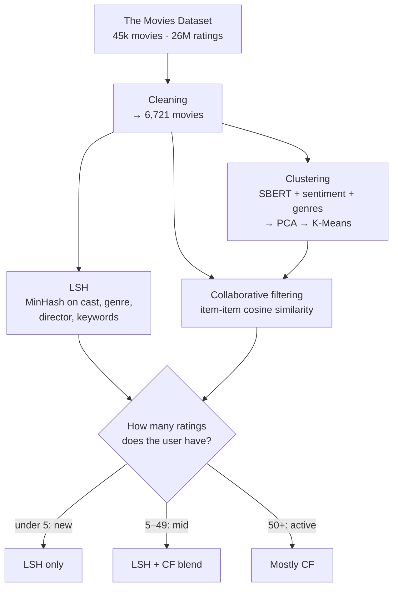

# Movie Taste Map: a hybrid movie recommender

This recommender combines three techniques: locality-sensitive hashing, semantic clustering and collaborative filtering. It changes how much weight each one gets depending on how much it knows about the user.

Built by Group 8 for DTU course 02807 *Computational Tools for Data Science*.

## How it works

**1. Data cleaning.** The project starts from [The Movies Dataset](https://www.kaggle.com/datasets/rounakbanik/the-movies-dataset) on Kaggle. Only 7.5k of the 45k movies have user ratings, so the rest were dropped. We also fixed invalid runtimes, removed movies with zero votes and duplicate IDs, and dropped budget and revenue, which were 70% zeros. That leaves **6,721 movies** with complete genre, cast and director data.

**2. LSH (content similarity).** Each movie becomes a set of features (genres, top 5 cast, director, keywords, collection). These sets are hashed into MinHash signatures (100 hash functions, 50 bands × 2 rows). LSH cuts the number of movie pairs to compare by **96.5%**, from 22.6M to 797k candidate pairs. The results are explainable, because shared features can be listed for every recommendation.

**3. Clustering (semantic similarity).** Plot overviews are embedded with SBERT (`all-MiniLM-L6-v2`) and combined with VADER sentiment, one-hot genres and scaled numeric features. PCA reduces these to 80 dimensions, and K-Means groups them into **10 clusters**. The cluster count was cross-checked with a hierarchical clustering dendrogram and visualised with UMAP.

**4. Collaborative filtering (user behaviour).** This is item-based cosine similarity on the user-movie rating matrix: 8,982 users × 3,959 movies from a 500k-rating sample, 98.6% sparse. Candidate movies are limited to the user's dominant cluster, which keeps recommendations focused.

**5. Hybrid.** New users get content-based recommendations, and active users get mostly collaborative filtering. Scores are min-max normalised before they are blended.

## Example

LSH recommendations for *The Dark Knight*: **Batman Begins** (0.37), Batman & Robin (0.21), Batman (0.19), Batman Returns (0.15). The shared features behind them include cast, *gotham city*, *vigilante* and *dc comics*.

## Limitations and next steps

- Collaborative filtering ran on a 500k-rating sample because of memory limits. Sparse matrices would make the full 14.7M ratings practical.
- The recommender hasn't been evaluated offline yet. The next step is to hold out ratings and measure RMSE and precision@k for each component and for the hybrid.
- Unrated movies are stored as 0 in the rating matrix, which can create false similarities. Mean-centred ratings would fix this.

## Tech stack

Python · pandas · scikit-learn · sentence-transformers · NLTK (VADER) · mmh3 · UMAP · SciPy
